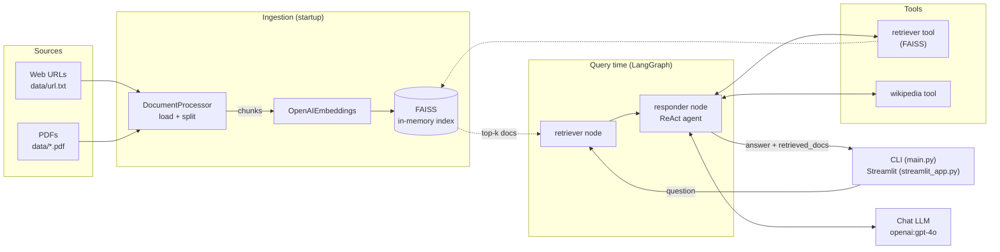
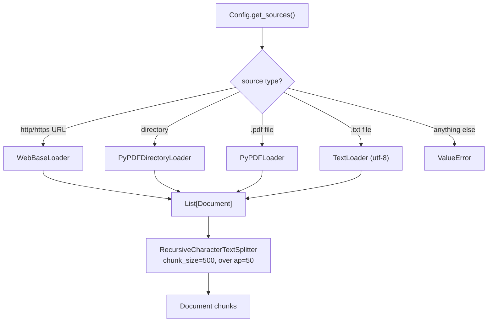
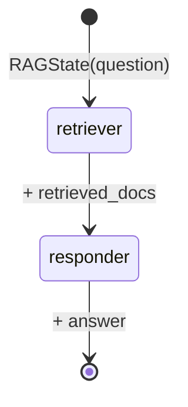
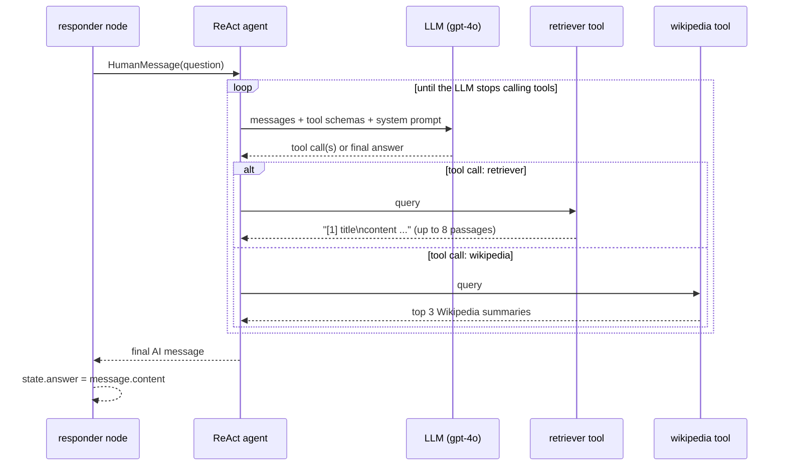

# rag1 — Agentic RAG with LangGraph

An **agentic Retrieval-Augmented Generation (RAG)** system that indexes web pages and PDFs into a FAISS vector store and answers questions with a **ReAct agent** orchestrated by **LangGraph**. The agent decides at runtime whether to search your own documents, look something up on Wikipedia, or both, before writing the final answer.

It ships with two front-ends:

- a **command-line app** (`main.py`) that runs sample questions and then an interactive Q&A loop
- a **Streamlit web app** (`streamlit_app.py`) with a search box, source-document viewer, response timing and recent-search history

---

## Table of contents

1. [Features](#features)
2. [Architecture](#architecture)
   - [High-level overview](#high-level-overview)
   - [Ingestion pipeline](#1-ingestion-pipeline)
   - [Vector store and retrieval](#2-vector-store-and-retrieval)
   - [LangGraph workflow](#3-langgraph-workflow)
   - [ReAct agent (inside the responder node)](#4-react-agent-inside-the-responder-node)
   - [State model](#5-state-model)
   - [End-to-end request lifecycle](#6-end-to-end-request-lifecycle)
3. [Project structure](#project-structure)
4. [Getting started](#getting-started)
5. [Configuration](#configuration)
6. [Usage](#usage)
7. [Using your own data](#using-your-own-data)
8. [Customisation](#customisation)
9. [Security](#security)
10. [Limitations and notes](#limitations-and-notes)
11. [Tech stack](#tech-stack)

---

## Features

- **Multi-source ingestion** — web pages (via `WebBaseLoader` + BeautifulSoup), single PDFs, whole PDF folders, and `.txt` files.
- **Chunking** — `RecursiveCharacterTextSplitter` (500 characters, 50 overlap by default).
- **Semantic search** — OpenAI embeddings stored in an in-memory **FAISS** index.
- **Graph-based orchestration** — a typed **LangGraph** `StateGraph` with a `retriever` node and a `responder` node.
- **Agentic answering** — the responder is a LangGraph prebuilt **ReAct agent** (`create_react_agent`) with two tools:
  - `retriever` — searches your indexed corpus
  - `wikipedia` — searches Wikipedia for general knowledge
- **Pluggable LLM** — any chat model supported by LangChain's `init_chat_model` (default `openai:gpt-4o`).
- **Two interfaces** — CLI and Streamlit.
- **Secrets kept out of git** — API keys are read from a local `.env` that is git-ignored; `.env.example` is the template.

---

## Architecture

### High-level overview



The system has two phases:

| Phase | When | What happens |
|---|---|---|
| **Indexing** | Once at startup (cached for the session in Streamlit) | Sources are loaded, split into chunks, embedded, and stored in FAISS. |
| **Querying** | Per question | LangGraph runs `retriever → responder`; the responder's ReAct agent calls tools in a loop and produces the final answer. |

### 1. Ingestion pipeline

Implemented in [`src/document_ingestion/document_processor.py`](src/document_ingestion/document_processor.py) and driven by [`src/config/config.py`](src/config/config.py).



1. **Source discovery** — `Config.get_sources()` reads one URL per line from `data/url.txt` (falling back to `Config.DEFAULT_URLS` if the file is missing or empty) and appends the `data/` directory if it contains any PDFs.
2. **Loading** — `DocumentProcessor.load_documents()` dispatches each source to the matching LangChain loader. Each loader returns `Document` objects with `page_content` and `metadata` (e.g. `source`, `title`, `page`).
3. **Splitting** — `split_documents()` breaks documents into ~500-character chunks with 50 characters of overlap so that context is not lost at chunk boundaries.
4. `process_urls()` runs load + split in one call and returns the chunks.

Out of the box the corpus is:

- Lilian Weng — *LLM Powered Autonomous Agents* (`2023-06-23-agent`)
- Lilian Weng — *Diffusion Models for Video Generation* (`2024-04-12-diffusion-video`)
- `data/attention.pdf` — *Attention Is All You Need* (15 pages)

### 2. Vector store and retrieval

Implemented in [`src/vectorstore/vectorstore.py`](src/vectorstore/vectorstore.py).

- `VectorStore.__init__` creates an `OpenAIEmbeddings()` client (uses `OPENAI_API_KEY` and langchain-openai's default embedding model).
- `create_vectorstore(documents)` calls `FAISS.from_documents(...)`, embedding every chunk and building an in-memory similarity index, then wraps it with `as_retriever()`.
- The retriever performs a similarity search and returns the **top 4** chunks (LangChain's default `k`).
- `get_retriever()` / `retrieve()` guard against use before the index exists.

The index lives only in memory; it is rebuilt every time the app starts.

### 3. LangGraph workflow

Implemented in [`src/graph_builder/graph_builder.py`](src/graph_builder/graph_builder.py).



`GraphBuilder.build()` creates a `StateGraph(RAGState)` with:

| Node | Function | Responsibility |
|---|---|---|
| `retriever` (entry point) | `RAGNodes.retrieve_docs` | Runs the FAISS retriever on the question and stores the hits in `retrieved_docs`. |
| `responder` | `RAGNodes.generate_answer` | Runs the ReAct agent and stores its final message in `answer`. |

Edges: `retriever → responder → END`. `GraphBuilder.run(question)` builds the graph lazily if needed, invokes it with `RAGState(question=...)`, and returns the final state as a dict (`question`, `retrieved_docs`, `answer`).

### 4. ReAct agent (inside the responder node)

Implemented in [`src/node/reactnode.py`](src/node/reactnode.py). This is what makes the system *agentic* rather than a fixed retrieve-then-generate pipeline.



- **Lazy construction** — the agent is built on the first question (`_build_agent`) and reused afterwards.
- **Tools** (`_build_tools`):
  - `retriever` — calls the FAISS retriever with the agent's own query (which may be a reformulation of the user's question) and formats each hit as `[i] <title or source>\n<content>`.
  - `wikipedia` — `WikipediaQueryRun` with `WikipediaAPIWrapper(top_k_results=3, lang="en")`.
- **System prompt** — *"You are a helpful RAG agent. Prefer 'retriever' for user-provided docs; use 'wikipedia' for general knowledge. Return only the final useful answer."*
- **Answer extraction** — the content of the last message in the agent's output becomes `answer`; if there is none, the fallback is `"Could not generate answer."`.

> **Note:** `retrieved_docs` (shown as "Source Documents" in the UI) comes from the graph's `retriever` node, using the original question. The agent runs its own retrieval through the `retriever` tool, so the passages it actually used can differ slightly, and answers may also draw on Wikipedia.

A simpler, non-agentic responder is kept in [`src/node/nodes.py`](src/node/nodes.py): it joins the retrieved chunks into a single prompt (`Context: ... Question: ...`) and makes one LLM call. See [Customisation](#customisation) to switch to it.

### 5. State model

Defined in [`src/state/rag_state.py`](src/state/rag_state.py) as a Pydantic model shared by all graph nodes:

```python
class RAGState(BaseModel):
    question: str
    retrieved_docs: List[Document] = []
    answer: str = ""
```

Each node receives the current state and returns a new `RAGState` with its fields filled in.

### 6. End-to-end request lifecycle

1. **Startup** — `.env` is loaded; `Config.get_llm()` checks `OPENAI_API_KEY` and initialises the chat model.
2. **Indexing** — sources → `DocumentProcessor` → chunks → `OpenAIEmbeddings` → FAISS.
3. **Graph compile** — `GraphBuilder(retriever, llm).build()`.
4. **Question** — the user types a question in the CLI or Streamlit.
5. **`retriever` node** — top-4 similar chunks are stored in `retrieved_docs`.
6. **`responder` node** — the ReAct agent loops: LLM → tool call(s) → observation → LLM … until it produces a final answer.
7. **Output** — the CLI prints the answer; Streamlit shows the answer, the first 300 characters of each retrieved chunk, the response time, and the last 3 searches.

---

## Project structure

```text
rag1/
├── main.py                     # CLI entry point (AgenticRAG class, sample questions, interactive loop)
├── streamlit_app.py            # Streamlit web UI
├── data/
│   ├── url.txt                 # Web pages to index, one URL per line
│   └── attention.pdf           # Sample PDF ("Attention Is All You Need")
├── src/
│   ├── config/
│   │   └── config.py           # Config: API key, model, chunking, data sources, get_llm()
│   ├── document_ingestion/
│   │   └── document_processor.py  # Loaders (URL/PDF/dir/TXT) + text splitter
│   ├── vectorstore/
│   │   └── vectorstore.py      # FAISS index + OpenAI embeddings + retriever
│   ├── state/
│   │   └── rag_state.py        # RAGState (Pydantic) shared by graph nodes
│   ├── node/
│   │   ├── reactnode.py        # Nodes used by the graph: retriever + ReAct-agent responder
│   │   └── nodes.py            # Alternative simple RAG nodes (single LLM call)
│   └── graph_builder/
│       └── graph_builder.py    # LangGraph StateGraph: retriever -> responder -> END
├── .env.example                # Template for your local .env (no real secrets)
├── .gitignore                  # Ignores .env, virtualenvs, caches, indexes
├── pyproject.toml              # Project metadata + dependencies (uv)
├── uv.lock                     # Locked dependency versions (uv)
├── requirements.txt            # pip-installable dependency list
└── .python-version             # Python 3.13
```

---

## Getting started

### Prerequisites

- **Python 3.13** (see `.python-version` / `pyproject.toml`)
- An **OpenAI API key** — <https://platform.openai.com/api-keys>
- Internet access (OpenAI API, the indexed web pages, and Wikipedia)

### 1. Clone

```bash
git clone https://github.com/AdithyaHrudai/rag1.git
cd rag1
```

### 2. Install dependencies

**Option A — uv (recommended, uses the lock file):**

```bash
uv sync
```

**Option B — pip:**

```bash
python -m venv .venv
# Windows
.venv\Scripts\activate
# macOS / Linux
source .venv/bin/activate

pip install -r requirements.txt
```

### 3. Add your API key

```bash
# Windows (PowerShell)
Copy-Item .env.example .env
# macOS / Linux
cp .env.example .env
```

Then edit `.env`:

```env
OPENAI_API_KEY=sk-...your key...
```

`.env` is listed in `.gitignore` and must never be committed.

---

## Configuration

Environment variables (in `.env`):

| Variable | Required | Default | Purpose |
|---|---|---|---|
| `OPENAI_API_KEY` | Yes | — | Used for both the chat model and embeddings. |
| `LLM_MODEL` | No | `openai:gpt-4o` | Any `provider:model` string accepted by LangChain's `init_chat_model`. |
| `USER_AGENT` | No | — | Sent by `WebBaseLoader` when fetching pages; setting it silences a warning. |

Code-level settings in [`src/config/config.py`](src/config/config.py):

| Setting | Default | Purpose |
|---|---|---|
| `CHUNK_SIZE` | `500` | Characters per chunk. |
| `CHUNK_OVERLAP` | `50` | Characters shared between neighbouring chunks. |
| `DATA_DIR` | `<project>/data` | Every PDF in this folder is indexed. |
| `URLS_FILE` | `<project>/data/url.txt` | Web pages to index (one per line). |
| `DEFAULT_URLS` | two Lilian Weng posts | Used if `url.txt` is missing or empty. |

---

## Usage

### Command line

```bash
uv run python main.py      # or: python main.py
```

The CLI will:

1. index the sources,
2. answer three example questions (agent loop, components of LLM agents, video diffusion models),
3. ask whether you want **interactive mode** — type questions, and `quit`, `exit` or `q` to leave.

Programmatic use:

```python
from main import AgenticRAG

rag = AgenticRAG()  # or AgenticRAG(urls=["https://...", "path/to/file.pdf", "path/to/pdf_folder"])
answer = rag.ask("What is multi-head attention?")
```

### Streamlit web app

```bash
uv run streamlit run streamlit_app.py      # or: streamlit run streamlit_app.py
```

Open the URL Streamlit prints (usually <http://localhost:8501>). The first load builds the index (this can take a little while); it is then cached for the lifetime of the server process.

---

## Using your own data

- **Web pages** — put one URL per line in `data/url.txt`.
- **PDFs** — drop `.pdf` files into `data/`; they are all indexed automatically.
- **Other locations** — pass any mix of URLs, `.pdf` files, `.txt` files and PDF folders to `AgenticRAG(urls=[...])` or `DocumentProcessor.process_urls([...])`.

Restart the app after changing data, because the index is built at startup.

---

## Customisation

- **Change the LLM** — set `LLM_MODEL` in `.env` (e.g. `openai:gpt-4o-mini`). Other providers need their LangChain integration package and API key installed.
- **Use the simple (non-agentic) responder** — in `src/graph_builder/graph_builder.py` change
  `from src.node.reactnode import RAGNodes` to `from src.node.nodes import RAGNodes`.
- **Add tools** — append more `Tool` objects in `RAGNodes._build_tools()` in `src/node/reactnode.py`.
- **Tune retrieval** — e.g. `self.vectorstore.as_retriever(search_kwargs={"k": 6})` in `src/vectorstore/vectorstore.py`.
- **Tune chunking** — change `CHUNK_SIZE` / `CHUNK_OVERLAP` in `Config`.

---

## Security

- API keys are loaded from `.env` with `python-dotenv` and are **never** hard-coded.
- `.env` (and any `.env.*` other than `.env.example`, plus `.streamlit/secrets.toml`) is git-ignored.
- `.env.example` documents the required variables with placeholder values only.
- If a key is ever committed or shared, **revoke it immediately** in the OpenAI dashboard and create a new one — removing the file from git does not make an exposed key safe again.
- The Streamlit app is meant for local use; it has no authentication, so do not expose it publicly with your key configured.

---

## Limitations and notes

- The FAISS index is in memory and rebuilt on every start, so each start re-embeds all chunks (OpenAI embedding cost and startup time grow with the corpus).
- Each question can trigger several LLM calls because of the ReAct loop.
- Web pages are fetched live; if a URL is down or changes, ingestion is affected.
- "Source Documents" in the UI are from the graph's retriever node, not necessarily the exact passages the agent used (see [ReAct agent](#4-react-agent-inside-the-responder-node)).
- Answers may combine your documents with Wikipedia content.

---

## Tech stack

| Layer | Library |
|---|---|
| Orchestration | LangGraph (`StateGraph`, `create_react_agent`) |
| LLM / embeddings | OpenAI via `langchain-openai` / `init_chat_model` |
| Vector store | FAISS (`faiss-cpu`) |
| Loaders | `langchain-community` (`WebBaseLoader`, `PyPDFLoader`, `PyPDFDirectoryLoader`, `TextLoader`), BeautifulSoup, pypdf |
| Splitting | `langchain-text-splitters` |
| External knowledge | `wikipedia` |
| State | Pydantic |
| UI | Streamlit |
| Config | python-dotenv |
