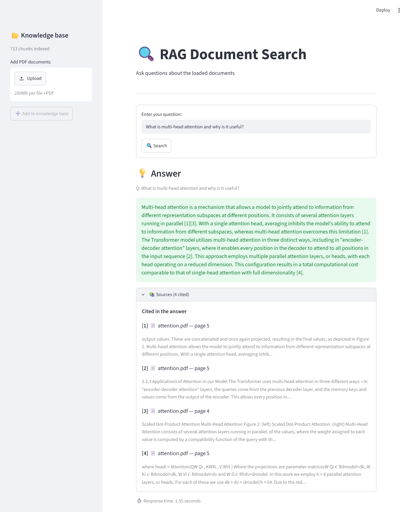
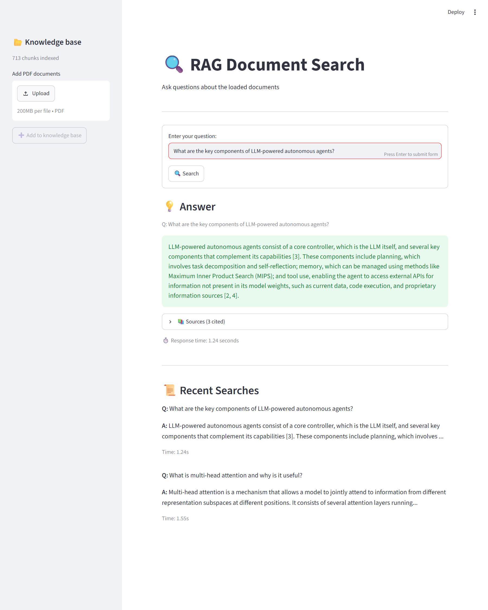
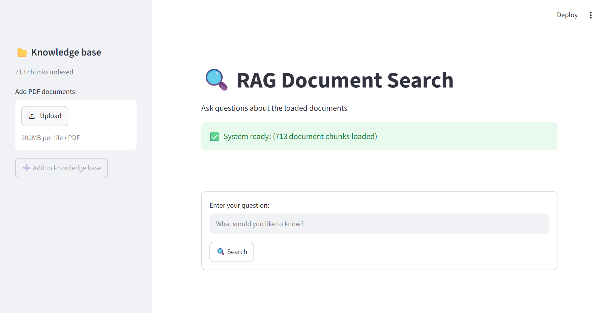
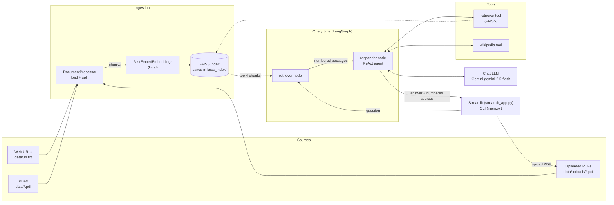
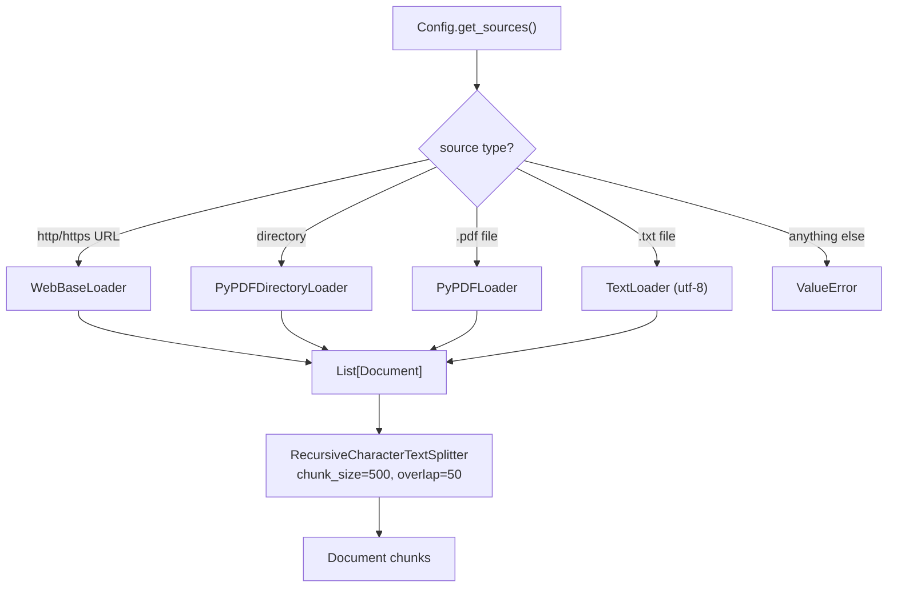
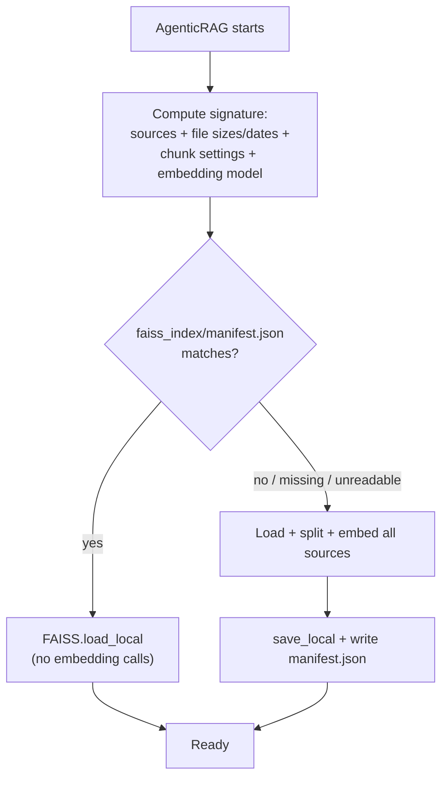
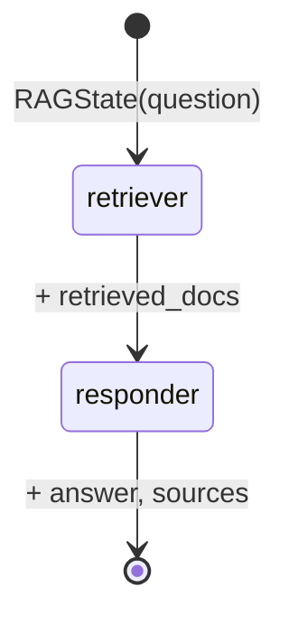
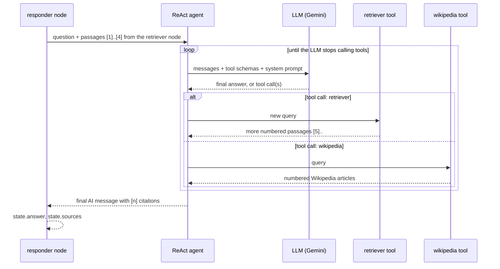

# rag1 — Agentic RAG with LangGraph

An **agentic Retrieval-Augmented Generation (RAG)** system that indexes web pages and PDFs into a FAISS vector store and answers questions with a **ReAct agent** orchestrated by **LangGraph**. The agent decides at runtime whether the passages it was given are enough, whether to search your documents again with a better query, or whether to look something up on Wikipedia. Every answer cites its sources as `[1]`, `[2]`, … and you can see exactly which document page or Wikipedia article each number refers to.

It ships with two front-ends:

- a **Streamlit web app** (`streamlit_app.py`) — ask questions, **upload your own PDFs**, and inspect the cited sources behind every answer
- a **command-line app** (`main.py`) — runs sample questions, then an interactive Q&A loop, printing the cited sources after each answer

---

## Screenshots

**Ask a question and inspect the sources.** Every `[n]` in the answer maps to a document page or Wikipedia article in the Sources panel, with the retrieved text.



**Web pages work the same way.** The answer below cites passages from the indexed blog post, and the panel (collapsed here) links to the source URL.



**The home screen** shows how many chunks are indexed and lets you add your own PDFs from the sidebar.



---

## Table of contents

1. [Screenshots](#screenshots)
2. [Features](#features)
3. [Architecture](#architecture)
   - [High-level overview](#high-level-overview)
   - [Ingestion pipeline](#1-ingestion-pipeline)
   - [Vector store, persistence and retrieval](#2-vector-store-persistence-and-retrieval)
   - [LangGraph workflow](#3-langgraph-workflow)
   - [ReAct agent (inside the responder node)](#4-react-agent-inside-the-responder-node)
   - [Sources and citations](#5-sources-and-citations)
   - [PDF upload](#6-pdf-upload)
   - [State model](#7-state-model)
   - [End-to-end request lifecycle](#8-end-to-end-request-lifecycle)
4. [Project structure](#project-structure)
5. [Getting started](#getting-started)
6. [Configuration](#configuration)
7. [Usage](#usage)
8. [Using your own data](#using-your-own-data)
9. [Customisation](#customisation)
10. [Security](#security)
11. [Limitations and notes](#limitations-and-notes)
12. [Tech stack](#tech-stack)

---

## Features

- **Multi-source ingestion** — web pages (via `WebBaseLoader` + BeautifulSoup), PDFs, PDF folders and `.txt` files.
- **PDF upload in the UI** — add PDFs from the Streamlit sidebar; they are chunked, embedded and searchable immediately, with no restart.
- **Persistent vector index** — the FAISS index is saved to disk and reloaded on start, so documents are only embedded once. It is rebuilt automatically when the sources change.
- **Chunking** — `RecursiveCharacterTextSplitter` (500 characters, 50 overlap by default).
- **Semantic search** — free local embeddings (FastEmbed, `BAAI/bge-small-en-v1.5` by default, no API key) in a **FAISS** index.
- **Graph-based orchestration** — a typed **LangGraph** `StateGraph` with a `retriever` node and a `responder` node.
- **Agentic answering** — the responder is a LangGraph prebuilt **ReAct agent** (`create_react_agent`) that receives the retrieved passages and can call two tools:
  - `retriever` — searches your documents again with its own query
  - `wikipedia` — searches Wikipedia for general knowledge
- **Cited answers** — every passage (document chunk or Wikipedia article) gets a number; the answer cites them as `[n]`, and the UI shows which sources were cited and which were only retrieved.
- **Free LLM via Gemini** — chat runs on Google Gemini's free tier (default `gemini-2.5-flash`); any Gemini model that supports tool calling works.
- **Tested** — unit tests for the citation logic and configuration, run in CI on every push.
- **Secrets kept out of git** — API keys are read from a local `.env` that is git-ignored; `.env.example` is the template.

---

## Architecture

### High-level overview



The system has two phases:

| Phase | When | What happens |
|---|---|---|
| **Indexing** | At startup (only if the sources changed) and whenever a PDF is uploaded | Sources are loaded, split into chunks, embedded, stored in FAISS and saved to disk. |
| **Querying** | Per question | LangGraph runs `retriever → responder`; the responder's ReAct agent answers from the numbered passages, calling tools when it needs more. |

All of this is wired together by the `AgenticRAG` class in [`src/rag_system.py`](src/rag_system.py), which both front-ends use.

### 1. Ingestion pipeline

Implemented in [`src/document_ingestion/document_processor.py`](src/document_ingestion/document_processor.py) and driven by [`src/config/config.py`](src/config/config.py).



1. **Source discovery** — `Config.get_sources()` reads one URL per line from `data/url.txt` (falling back to `Config.DEFAULT_URLS` if the file is missing or empty) and adds every PDF in `data/` and `data/uploads/`.
2. **Loading** — `DocumentProcessor.load_documents()` dispatches each source to the matching LangChain loader. Each loader returns `Document` objects with `page_content` and `metadata` (`source`, plus `title` for web pages and `page` for PDFs).
3. **Splitting** — `split_documents()` breaks documents into ~500-character chunks with 50 characters of overlap so that context is not lost at chunk boundaries.
4. `process_urls()` runs load + split in one call and returns the chunks.

Out of the box the corpus is:

- Lilian Weng — *LLM Powered Autonomous Agents* (`2023-06-23-agent`)
- Lilian Weng — *Diffusion Models for Video Generation* (`2024-04-12-diffusion-video`)
- `data/attention.pdf` — *Attention Is All You Need* (15 pages)

### 2. Vector store, persistence and retrieval

Implemented in [`src/vectorstore/vectorstore.py`](src/vectorstore/vectorstore.py) and [`src/rag_system.py`](src/rag_system.py).

- `VectorStore` wraps a FAISS index built with `FastEmbedEmbeddings(model_name=EMBEDDING_MODEL)`.
- `create_vectorstore(documents)` embeds every chunk with `FAISS.from_documents(...)`; `add_documents(documents)` embeds and appends new chunks to the existing index.
- The retriever (`as_retriever()`) runs a similarity search and returns the **top 4** chunks. Because it wraps the same index object, chunks added later are searchable immediately.

**Persistence.** Embedding is the slow part of indexing, so the index is saved and reused:



- `faiss_index/` holds `index.faiss` (the vectors), `index.pkl` (the chunk texts and metadata) and `manifest.json` (the signature it was built from).
- Changing `data/url.txt`, adding/removing/editing a PDF, changing `CHUNK_SIZE`/`CHUNK_OVERLAP`, or switching `EMBEDDING_MODEL` changes the signature, so the index is rebuilt automatically on the next start.
- `faiss_index/` is git-ignored; it is created locally on first run.

### 3. LangGraph workflow

Implemented in [`src/graph_builder/graph_builder.py`](src/graph_builder/graph_builder.py).



`GraphBuilder.build()` creates a `StateGraph(RAGState)` with:

| Node | Function | Responsibility |
|---|---|---|
| `retriever` (entry point) | `RAGNodes.retrieve_docs` | Runs the FAISS retriever on the question and stores the top 4 chunks in `retrieved_docs`. |
| `responder` | `RAGNodes.generate_answer` | Numbers the retrieved chunks, runs the ReAct agent, and stores the `answer` and the numbered `sources`. |

Edges: `retriever → responder → END`. `GraphBuilder.run(question)` invokes the graph with `RAGState(question=...)` and returns the final state as a dict (`question`, `retrieved_docs`, `answer`, `sources`).

### 4. ReAct agent (inside the responder node)

Implemented in [`src/node/reactnode.py`](src/node/reactnode.py). This is what makes the system *agentic* rather than a fixed retrieve-then-generate pipeline.



- **Passages first** — the chunks found by the `retriever` node are passed to the agent with the question. If they are enough, the agent answers in a single LLM call; it only uses tools when it needs more.
- **Tools** (`_build_tools`):
  - `retriever` — searches the FAISS index with the agent's own query (often a rephrasing of the question).
  - `wikipedia` — `WikipediaAPIWrapper(top_k_results=2, doc_content_chars_max=2000)`; returns the top articles with their titles and URLs. The app sets a proper User-Agent, because Wikipedia rate-limits the library's generic default one.
- **System prompt** — tells the agent to answer from the given passages when they are enough, otherwise to use `retriever` or `wikipedia` (at most two tool calls), to cite every fact as `[n]` using only the numbers it was given, and to say it could not find the answer only after trying the tools.
- **Step limit** — the agent runs with a recursion limit (`MAX_AGENT_STEPS`), so a model that keeps searching still ends with an answer and the free-tier API budget is protected.
- **Built per question** — the agent and its tools are created for each question so that each answer has its own source numbering (safe when several Streamlit users ask at once).
- **Answer extraction** — the text of the agent's last message becomes `answer`. Some models (Gemini included) return a list of content blocks instead of a string, so `message_text()` in `sources.py` flattens either form; if there is no text, the fallback is `"Could not generate answer."`.

A simpler, non-agentic responder is kept in [`src/node/nodes.py`](src/node/nodes.py): it puts the numbered chunks into a single prompt and makes one LLM call, with the same citation format. See [Customisation](#customisation) to switch to it.

### 5. Sources and citations

Implemented in [`src/node/sources.py`](src/node/sources.py).

A `SourceRegistry` is created for every question. Each passage the agent sees — from the retriever node, the `retriever` tool or the `wikipedia` tool — is registered and rendered for the LLM like this:

```text
[1] attention.pdf (page 4)
An attention function can be described as mapping a query and a set of key-value pairs ...

[5] Transformer (deep learning) (https://en.wikipedia.org/wiki/Transformer_(deep_learning))
In deep learning, the transformer is a family of artificial neural network architectures ...
```

- Numbers are assigned in the order passages are first seen; a passage retrieved twice keeps its original number.
- After the answer is generated, `finalize()` finds the references in it — `[1]`, `[2][3]` and grouped forms such as `[2, 4]` — and marks those sources as `cited`.
- Each source is returned as `{id, type, title, location, content, cited}`, where `type` is `document` or `wikipedia` and `location` is a page number or URL.
- Streamlit shows a **Sources** panel under each answer: cited sources first, then the ones that were retrieved but not used. The CLI prints the cited sources after the answer.

### 6. PDF upload

Implemented in [`streamlit_app.py`](streamlit_app.py) (`upload_sidebar`) and `AgenticRAG.add_pdf` in [`src/rag_system.py`](src/rag_system.py).

1. The user selects one or more PDFs in the sidebar and clicks **Add to knowledge base**.
2. Each file is saved to `data/uploads/` (a file with the same name and size is skipped; a different file with the same name is rejected so the index never holds two versions).
3. `add_pdf()` loads it with `PyPDFLoader`, splits it, embeds the chunks and appends them to the FAISS index — the next question can already use it.
4. The index and manifest are saved, so on the next start the upload is part of the saved index and nothing is re-embedded.

PDFs without extractable text (e.g. scanned images) are rejected with an error message.

### 7. State model

Defined in [`src/state/rag_state.py`](src/state/rag_state.py) as a Pydantic model shared by all graph nodes:

```python
class RAGState(BaseModel):
    question: str
    retrieved_docs: List[Document] = []
    answer: str = ""
    sources: List[dict] = []   # {id, type, title, location, content, cited}
```

Each node receives the current state and returns a new `RAGState` with its fields filled in.

### 8. End-to-end request lifecycle

1. **Startup** — `.env` is loaded; `Config.get_llm()` checks `GOOGLE_API_KEY` and initialises the Gemini chat model.
2. **Index** — if `faiss_index/` matches the current sources it is loaded; otherwise sources → `DocumentProcessor` → chunks → `FastEmbedEmbeddings` → FAISS → saved.
3. **Graph compile** — `GraphBuilder(retriever, llm).build()`.
4. **Question** — the user asks in Streamlit or the CLI.
5. **`retriever` node** — the top 4 similar chunks are stored in `retrieved_docs`.
6. **`responder` node** — the chunks are numbered and given to the ReAct agent, which answers directly or loops LLM → tool call → observation (within the step limit) until it can answer, citing `[n]`.
7. **Output** — the answer plus its numbered sources; Streamlit also shows the response time and the last 3 searches.

---

## Project structure

```text
rag1/
├── main.py                     # CLI entry point (sample questions, interactive loop)
├── streamlit_app.py            # Streamlit web UI: search, PDF upload sidebar, sources panel
├── data/
│   ├── url.txt                 # Web pages to index, one URL per line
│   ├── attention.pdf           # Sample PDF ("Attention Is All You Need")
│   └── uploads/                # PDFs uploaded through the UI (created on first upload, git-ignored)
├── faiss_index/                # Saved FAISS index + manifest.json (created on first run, git-ignored)
├── src/
│   ├── rag_system.py           # AgenticRAG: builds/loads the index, adds PDFs, runs the graph
│   ├── config/
│   │   └── config.py           # Config: API key, models, chunking, data/index folders, get_llm()
│   ├── document_ingestion/
│   │   └── document_processor.py  # Loaders (URL/PDF/dir/TXT) + text splitter
│   ├── vectorstore/
│   │   └── vectorstore.py      # FAISS index: create, add, save, load, retrieve
│   ├── state/
│   │   └── rag_state.py        # RAGState (Pydantic) shared by graph nodes
│   ├── node/
│   │   ├── reactnode.py        # Nodes used by the graph: retriever + ReAct-agent responder
│   │   ├── nodes.py            # Alternative simple RAG nodes (single LLM call)
│   │   └── sources.py          # SourceRegistry: numbers passages and tracks citations
│   └── graph_builder/
│       └── graph_builder.py    # LangGraph StateGraph: retriever -> responder -> END
├── tests/                      # pytest unit tests (citations, config) - no API key needed
├── docs/screenshots/           # Screenshots used in this README
├── .github/workflows/tests.yml # CI: runs pytest on every push and pull request
├── .env.example                # Template for your local .env (no real secrets)
├── .gitignore                  # Ignores .env, virtualenvs, caches, index, uploads
├── pyproject.toml              # Project metadata + dependencies (uv)
├── uv.lock                     # Locked dependency versions (uv)
├── requirements.txt            # pip-installable dependency list
├── requirements-dev.txt        # Test dependencies (pytest)
└── .python-version             # Python 3.13
```

---

## Getting started

### Prerequisites

- **Python 3.13** (see `.python-version` / `pyproject.toml`)
- A **free Gemini API key** — <https://aistudio.google.com/apikey> (Google account, no credit card needed)
- Internet access (Gemini API, the indexed web pages, and Wikipedia; the embedding model is downloaded once on first run, then runs locally)

### 1. Clone

```bash
git clone https://github.com/AdithyaHrudai/rag1.git
cd rag1
```

### 2. Install dependencies

**Option A — uv (recommended, uses the lock file):**

```bash
uv sync
```

**Option B — pip:**

```bash
python -m venv .venv
# Windows
.venv\Scripts\activate
# macOS / Linux
source .venv/bin/activate

pip install -r requirements.txt
```

### 3. Add your API key

```bash
# Windows (PowerShell)
Copy-Item .env.example .env
# macOS / Linux
cp .env.example .env
```

Then edit `.env`:

```env
GOOGLE_API_KEY=...your key...
```

`.env` is listed in `.gitignore` and must never be committed.

---

## Configuration

Environment variables (in `.env`):

| Variable | Required | Default | Purpose |
|---|---|---|---|
| `GOOGLE_API_KEY` | Yes | — | Used for the chat model. Embeddings run locally and need no key. |
| `LLM_MODEL` | No | `gemini-2.5-flash` | Any Gemini chat model that supports tool calling. |
| `EMBEDDING_MODEL` | No | `BAAI/bge-small-en-v1.5` | FastEmbed model name (runs locally). Changing it rebuilds the index on the next start. |
| `USER_AGENT` | No | `rag1-agentic-rag/0.1 (https://github.com/AdithyaHrudai/rag1)` | User-Agent sent when fetching web pages and Wikipedia. |

Code-level settings in [`src/config/config.py`](src/config/config.py):

| Setting | Default | Purpose |
|---|---|---|
| `CHUNK_SIZE` | `500` | Characters per chunk. |
| `CHUNK_OVERLAP` | `50` | Characters shared between neighbouring chunks. |
| `DATA_DIR` | `<project>/data` | Every PDF in this folder is indexed. |
| `URLS_FILE` | `<project>/data/url.txt` | Web pages to index (one per line). |
| `UPLOAD_DIR` | `<project>/data/uploads` | Where PDFs uploaded through the UI are stored; all are indexed. |
| `INDEX_DIR` | `<project>/faiss_index` | Where the FAISS index and its manifest are saved. |
| `DEFAULT_URLS` | two Lilian Weng posts | Used if `url.txt` is missing or empty. |

---

## Usage

### Streamlit web app

```bash
uv run streamlit run streamlit_app.py      # or: streamlit run streamlit_app.py
```

Open the URL Streamlit prints (usually <http://localhost:8501>).

- The first start builds and saves the index (this takes a little while); later starts load it from `faiss_index/` in seconds.
- **Ask** a question in the search box. The answer appears with `[n]` citations, and the **Sources** panel below it shows each cited document page or Wikipedia article (with a link), followed by passages that were retrieved but not cited.
- **Upload** PDFs from the sidebar with **Add to knowledge base**. The sidebar shows how many chunks are indexed and lists the uploaded files.

### Command line

```bash
uv run python main.py      # or: python main.py
```

The CLI will:

1. load or build the index,
2. answer three example questions (agent loop, components of LLM agents, video diffusion models), printing the cited sources after each answer,
3. ask whether you want **interactive mode** — type questions, and `quit`, `exit` or `q` to leave.

### Programmatic use

```python
from src.rag_system import AgenticRAG   # `from main import AgenticRAG` also works

rag = AgenticRAG()  # or AgenticRAG(urls=["https://...", "path/to/file.pdf", "path/to/pdf_folder"])

rag.add_pdf("path/to/report.pdf")          # add a document without restarting

result = rag.query("What is multi-head attention?")
print(result["answer"])
for s in result["sources"]:
    if s["cited"]:
        print(f"[{s['id']}] {s['title']} — {s['location']}")
```

`rag.ask(question)` does the same and prints the answer and its cited sources.

### Tests

```bash
pip install -r requirements-dev.txt
python -m pytest -q
```

The unit tests cover citation handling and configuration and need no API key or network. The same command runs in GitHub Actions on every push and pull request.

---

## Using your own data

- **Upload in the UI** — use the Streamlit sidebar; files are saved to `data/uploads/` and indexed immediately.
- **Web pages** — put one URL per line in `data/url.txt`.
- **PDFs** — drop `.pdf` files into `data/` (or `data/uploads/`).
- **Other locations** — pass any mix of URLs, `.pdf` files, `.txt` files and PDF folders to `AgenticRAG(urls=[...])`.

After editing `url.txt` or the files in `data/` by hand, restart the app: the changed sources are detected and the index is rebuilt.

---

## Customisation

- **Change the LLM** — set `LLM_MODEL` in `.env` (e.g. `gemini-2.5-flash-lite` has its own free quota but rarely uses the tools; see [Limitations](#limitations-and-notes)). Other providers need `Config.get_llm()` changed and their LangChain integration package installed.
- **Change the embedding model** — set `EMBEDDING_MODEL` in `.env` (e.g. `BAAI/bge-base-en-v1.5`); the index is rebuilt automatically.
- **Use the simple (non-agentic) responder** — in `src/graph_builder/graph_builder.py` change
  `from src.node.reactnode import RAGNodes` to `from src.node.nodes import RAGNodes`.
- **Add tools** — add more `StructuredTool` objects (typed arguments keep Gemini's function calling reliable) in `RAGNodes._build_tools()` in `src/node/reactnode.py`; use `registry.format(docs, ...)` so their results are numbered and citable.
- **Tune retrieval** — e.g. `self.vectorstore.as_retriever(search_kwargs={"k": 6})` in `src/vectorstore/vectorstore.py`.
- **Tune chunking** — change `CHUNK_SIZE` / `CHUNK_OVERLAP` in `Config` (the index is rebuilt automatically).
- **Force a full rebuild** — delete the `faiss_index/` folder.

---

## Security

- API keys are loaded from `.env` with `python-dotenv` and are **never** hard-coded.
- `.env` (and any `.env.*` other than `.env.example`, plus `.streamlit/secrets.toml`) is git-ignored.
- `.env.example` documents the required variables with placeholder values only.
- If a key is ever committed or shared, **revoke it immediately** in Google AI Studio and create a new one — removing the file from git does not make an exposed key safe again.
- `faiss_index/index.pkl` is loaded with pickle (`allow_dangerous_deserialization=True`). That is safe for an index this app wrote itself; never load index files from an untrusted source.
- Uploaded PDFs and the saved index stay on your machine and are git-ignored.
- The Streamlit app is meant for local use; it has no authentication, so do not expose it publicly with your key configured.

---

## Limitations and notes

- Web pages are fetched live when the index is built; if a page changes later, restart after deleting `faiss_index/` to pick up the new content (URL changes are only detected when the URL list itself changes).
- Each question can trigger several LLM calls when the agent decides to use tools.
- **Gemini free-tier limits.** The free tier is capped per model and per day (about 20 requests/day for `gemini-2.5-flash` at the time of writing), and a tool-using question can make 3-5 calls. When the quota is used up you get a `429 RESOURCE_EXHAUSTED` message in the UI; wait for the reset or point `LLM_MODEL` at another Gemini model, which has its own quota. The agent is limited to two tool calls per question to keep usage down.
- **Model choice matters for the agent.** Smaller models such as `gemini-2.5-flash-lite` often answer "not found" instead of calling the Wikipedia or retriever tools. Use a full Flash-class model if you want the agentic behaviour.
- Answers may combine your documents with Wikipedia content; the Sources panel shows which is which.
- Scanned PDFs without a text layer can't be indexed (no OCR).
- Uploaded files can't be removed from the UI; delete them from `data/uploads/` and restart to rebuild the index without them.

---

## Tech stack

| Layer | Library |
|---|---|
| Orchestration | LangGraph (`StateGraph`, `create_react_agent`) |
| LLM | Gemini via `langchain-google-genai` (`ChatGoogleGenerativeAI`) |
| Embeddings | FastEmbed (local ONNX) via `langchain-community` |
| Vector store | FAISS (`faiss-cpu`), saved with `save_local` / `load_local` |
| Loaders | `langchain-community` (`WebBaseLoader`, `PyPDFLoader`, `PyPDFDirectoryLoader`, `TextLoader`), BeautifulSoup, pypdf |
| Splitting | `langchain-text-splitters` |
| External knowledge | `wikipedia` (via `WikipediaAPIWrapper`) |
| State | Pydantic |
| UI | Streamlit |
| Config | python-dotenv |
